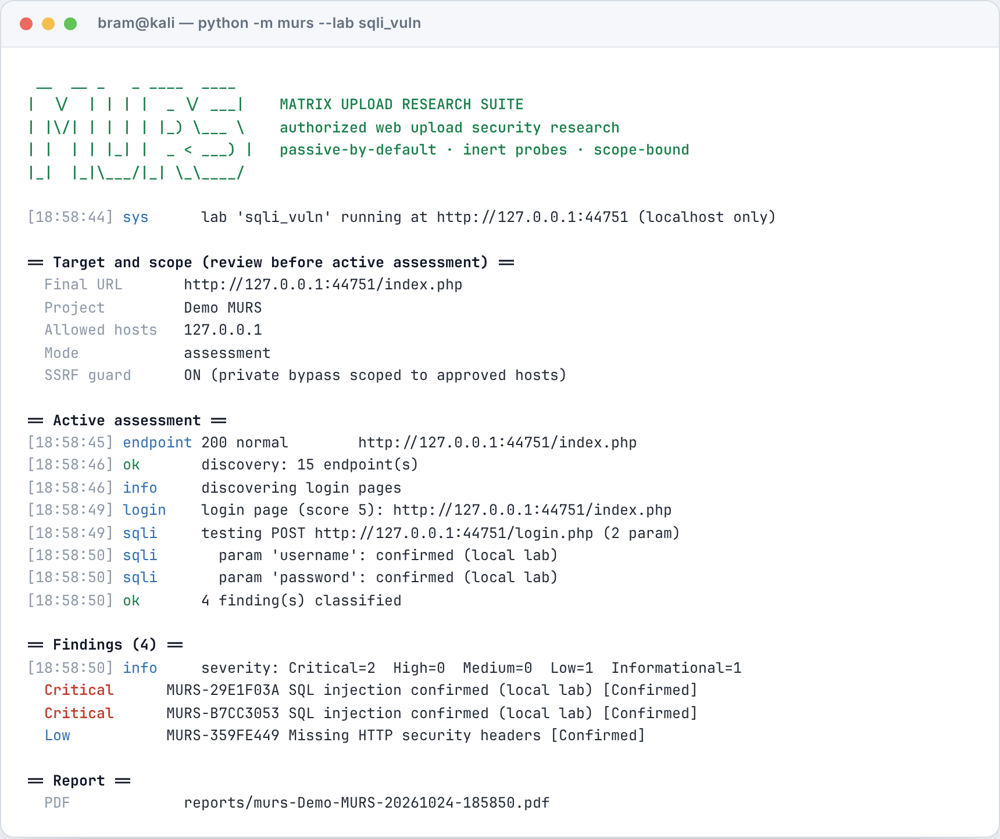

# MURS — Matrix Upload Research Suite

Tool buat riset keamanan web, fokusnya di **keamanan upload file** plus
sekarang udah bisa nyari halaman login dan ngecek **SQL injection**. Semua
jalan dari terminal, hasilnya bisa diekspor jadi laporan PDF.



> Singkatnya: kamu kasih URL target yang **boleh** kamu tes, MURS nyusurin
> situsnya, nyoba hal-hal yang aman buat nguji, terus bikin laporan. Dia nggak
> ngerusak apa-apa dan nggak nembus login orang.

## About

Halo, saya **Bram**. MURS ini project belajar saya soal keamanan aplikasi web —
awalnya iseng pengen ngerti gimana cara kerja celah upload file (yang suka
berujung ke webshell), terus kebablasan jadi suite kecil yang lumayan lengkap.

Daripada cuma baca teori, saya bikin tool yang beneran jalan: ada engine-nya,
ada lab rentan buatan sendiri buat latihan, ada test suite-nya, sampai laporan
PDF biar kayak kerjaan beneran. Jadi project ini separuh alat, separuh catatan
belajar.

Satu hal yang saya pegang dari awal: tool ini buat kerjaan yang **punya izin**.
Dia ngebantu kamu *nemuin* dan *mendokumentasikan* masalah, bukan buat
nerobos sistem orang. Pembuktian yang "berbahaya" (kayak eksekusi kode atau
bypass login) sengaja saya kurung di lab lokal, bukan ke target beneran.

## Bisa ngapain aja?

- **Scan upload pasif** — kasih URL, MURS baca apa yang server buka: header
  keamanan, cookie, file sensitif yang kebuka, teknologi/CMS, dll. Cuma GET,
  nggak nyerang.
- **Uji keamanan upload** — kalau nemu form upload, dia nyoba file penanda
  **inert** (nggak berbahaya) buat ngecek: filenya diterima nggak, kesimpan di
  mana, bisa diakses nggak, dieksekusi nggak. Statusnya jelas, nggak asal nebak.
- **Analisis URL / phishing** (`/analyze` offline) — cek link mencurigakan tanpa
  ngirim request ke mana-mana.
- **Nyari halaman login / admin** — dari form, pola URL, sama wordlist.
- **Cek SQL injection** — non-destruktif, berbasis bukti (error-based +
  boolean). Nggak asal nyimpulin dari status HTTP.
- **Laporan PDF otomatis** + bisa **retest** (bandingin sebelum/sesudah
  diperbaiki).
- **Lab lokal** rentan vs udah-diperbaiki, buat latihan dan buktiin konsep
  dengan aman.

Yang perlu diinget: deteksi itu **best-effort**, bukan jaminan. Hasil bersih
bukan berarti aman 100%.

## Butuh apa buat jalanin

- **Python 3.10+** dan **reportlab** (buat PDF).
- **php** CLI kalau mau pakai lab lokal.
- Sisanya pakai standard library Python, jadi nggak ribet.

```bash
git clone https://github.com/b3n3d1ck/murs && cd murs
python3 -m pip install -r requirements.txt   # install reportlab
# opsional, buat lab: apt install php-cli
```

Nggak perlu di-install juga sebenernya, bisa langsung jalan dari folder-nya.

## Cara jalanin

Semua ini sama aja, pilih yang enak:

```bash
./run.sh            <argumen>     # Linux / macOS / WSL / Kali / Ubuntu
run.cmd             <argumen>     # Windows CMD
powershell -File run.ps1 <argumen>  # Windows PowerShell
python -m murs      <argumen>     # platform apa aja
```

### Scan target yang kamu punya izinnya

```bash
python -m murs https://situs-kamu.example \
  --project "Review upload Q1" --researcher "nama kamu" \
  --scope-host situs-kamu.example --depth 2 --max-requests 300 --rate 6
```

MURS bakal nampilin **URL final + scope** dulu sebelum mulai, baru jalan. Target
yang ngarah ke alamat lokal/privat otomatis ditolak (biar nggak kena SSRF).

### Nyari login + uji SQLi (opsional, harus diaktifin)

Ini fiturnya **nggak otomatis** — harus diminta:

```bash
# cari halaman login dalam scope
python -m murs https://situs-kamu.example --login-discovery

# + uji SQLi (non-destruktif) di form yang ketemu
python -m murs https://situs-kamu.example --sqli --sqli-delay 2 --per-host-max 200
```

Kalau fiturnya nggak keluar di laporan, kemungkinan besar kamu lupa flag-nya.
Cek bagian "Scope JSON" di appendix PDF: kalau `enable_login` / `enable_sqli`
masih `False`, berarti modulnya emang nggak dijalanin.

### Pakai sesi login sendiri (kalau butuh)

Buat target yang perlu login dan kamu punya sesinya:

```bash
# lebih aman lewat environment variable (nggak kesimpen di history shell)
export MURS_AUTH_COOKIE="session=<sesi-tes-kamu>"
python -m murs https://situs-kamu.example --login-discovery
```

Nilai yang kamu kasih cuma dikirim ke host yang in-scope, **nggak** ditulis ke
PDF/log, dan dibuang kalau redirect pindah origin. Catatan jujur: kalau dikasih
lewat flag (`--auth-cookie`), nilainya bisa keliatan di process list / history —
makanya mending pakai env var.

## Lab lokal

Buat latihan dan buktiin konsep tanpa ganggu siapa-siapa. Semua jalan cuma di
`127.0.0.1`:

```bash
python -m murs --lab vuln          # app upload sengaja dibikin rentan
python -m murs --lab patched       # versi udah diperbaiki, buat pembanding
python -m murs --lab sqli_vuln     # login SQLite rentan (string digabung langsung)
python -m murs --lab sqli_patched  # login pakai prepared statement (aman)
```

Di `sqli_vuln`, SQLi-nya bisa sampai status **confirmed** karena ini lab yang
emang disediain buat itu. Di target beneran, hasilnya cuma **indikasi**
(High/Potential) buat dikonfirmasi manual — konfirmasi penuhnya ya di lab.

## Soal SQL injection (biar nggak salah paham)

MURS ngecek SQLi pakai cara yang **aman dan berbasis bukti**:

- Ambil respons baseline dulu, baru kirim probe diagnostik: tanda petik /
  kurung buat mancing error, sama pembanding boolean `AND '1'='1'` vs `'1'='2'`.
- Nggak pakai `OR 1=1` buat bypass login, nggak pakai komentar `--`/`#`, nggak
  pakai query bertumpuk `;`, nggak narik data pakai `UNION`.
- Yang dilaporin: **error-based** (muncul error khas DB yang di baseline nggak
  ada — bukan sekadar 500) atau **boolean-based** (beda respons true vs false).
- Nggak pernah nyimpulin SQLi cuma dari status HTTP atau error generik.

Jadi dia bilang "ini kemungkinan rentan dan ini buktinya", bukan "ayo saya
masukin ke dalam". Buat ngebuktiin eksploitasinya, pakai lab lokal.

## Laporan PDF & retest

PDF-nya kebuat otomatis (kecuali `--no-pdf`). Isinya cover, identitas project,
ringkasan, scope + batasan, daftar endpoint, matriks hasil upload, halaman login
+ hasil SQLi (kalau dijalanin), temuan terverifikasi vs potensial, detail tiap
temuan (bukti, dampak, langkah reproduksi aman, saran perbaikan), prioritas
perbaikan, hasil retest, sampai lampiran teknis. Ada nomor halaman + metadata.

Retest buat bandingin sebelum/sesudah fix:

```bash
python -m murs https://situs-kamu.example --save-findings baseline.json
# ... setelah diperbaiki ...
python -m murs https://situs-kamu.example --retest-baseline baseline.json
```

## Ngatur kecepatan request

Khusus uji SQLi ada scheduler-nya: jeda antar-request bisa diatur (default **2
detik**), ada batas request global + per-host, dan kalau server balas **429**
dia berhenti bentar sambil hormatin `Retry-After`. Nggak ada akal-akalan ganti
identitas buat ngakalin limit server.

## Testing

```bash
python -m unittest discover -s tests -v
```

Test-nya pakai fixture lokal sama lab PHP, jadi nggak nyentuh situs pihak
ketiga. Yang butuh `php` bakal di-skip (bukan gagal) kalau php-nya nggak ada.

## Keterbatasan (yang jujur aja)

- Discovery jalan satu-satu (serial) di bawah rate limit; opsi `concurrency`
  masih disimpen buat nanti, belum paralel.
- DNS rebinding udah dikurangin (socket di-pin ke IP yang udah divalidasi, jawaban
  DNS campur publik/privat ditolak), tapi cache poisoning level OS di luar
  kendali tool.
- Nggak ngejalanin JavaScript, jadi app yang full SPA bisa kelewat — ini
  dilaporin, nggak disembunyiin.
- Lokasi file upload cuma dianggap valid kalau markernya beneran ke-ambil;
  tebakan path nggak pernah dilaporin sebagai "confirmed".
- Lab buktiin eksekusi buat kasus **PHP** doang.

## Scope & etika

MURS ini buat orang yang **punya izin** buat nge-tes sistemnya. Dia nggak ngasih
izin itu. Jalanin cuma ke sistem yang kamu punya atau yang emang dibolehin.
Nyerang sistem orang tanpa izin itu bisa kena masalah hukum — tanggung jawab ada
di kamu.

Dan khusus bagian lab `vuln`/`sqli_vuln`: itu sengaja dibikin rapuh buat
latihan, jadi jangan di-deploy ke tempat yang bisa diakses publik.
